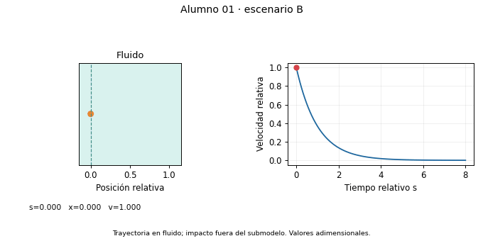
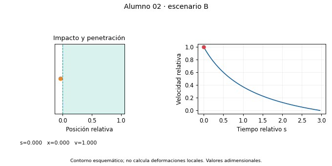
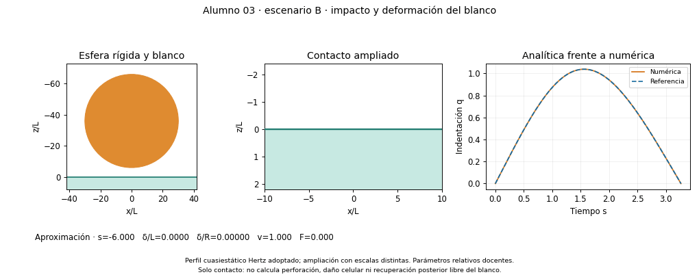
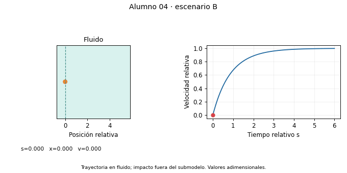
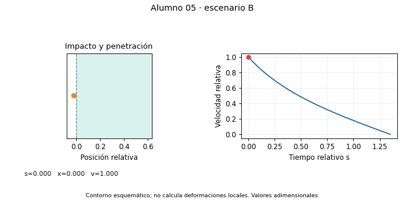
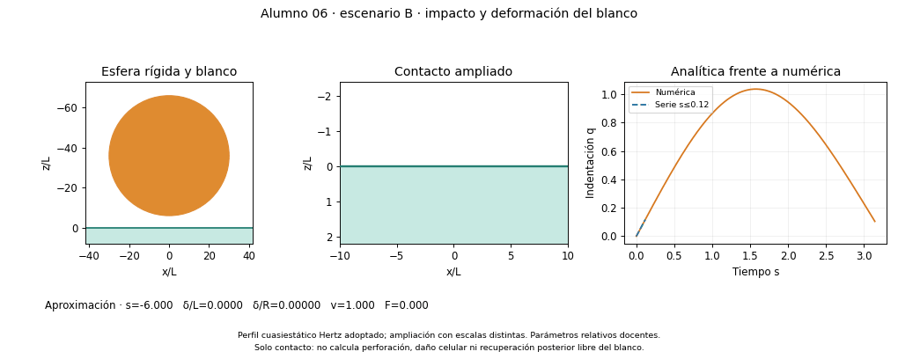
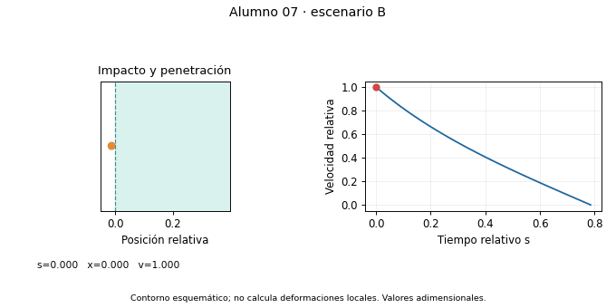
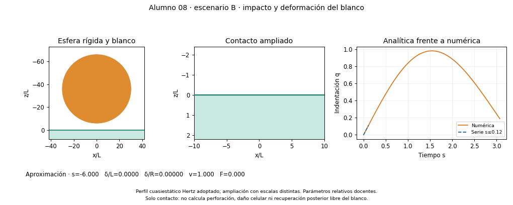
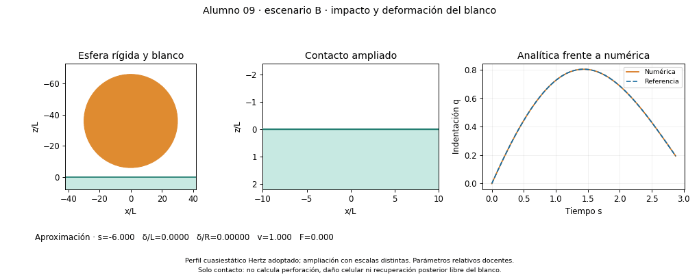

> **ARCHIVO AUXILIAR DE MECÁNICA DE CONTACTO. Las nueve actividades actuales comienzan en [README.md](README.md#empieza-aquí-actividad-para-alumnos).**

# Archivo auxiliar: fundamentos de contacto

Este archivo conserva nueve ejercicios de mecánica de contacto: esfera rígida y blanco deformable escalar. Incluye lecturas, deducciones analíticas, código y escenarios como apoyo complementario. Su numeración AUX 01–09 es independiente de las nueve fichas ALUMNO actuales.

Estos ejercicios permiten estudiar soluciones analíticas y compararlas con cálculos numéricos. Sus artículos son de mecánica del impacto; no integran la selección actual de biobalística y penetración mecánica. Las adaptaciones y submodelos están declarados en cada ficha CONTACTO_AUX.

## Índice de ejercicios auxiliares

| Auxiliar | Artículo | DOI | Modelo |
|---|---|---|---|
| [01](CONTACTO_AUX_01.md) | Argatov (2024) | [10.3390/lubricants12060193](https://doi.org/10.3390/lubricants12060193) | hertz |
| [02](CONTACTO_AUX_02.md) | Hunt y Crossley (1975) | [10.1115/1.3423596](https://doi.org/10.1115/1.3423596) | hc |
| [03](CONTACTO_AUX_03.md) | Lankarani y Nikravesh (1990) | [10.1115/1.2912617](https://doi.org/10.1115/1.2912617) | ln |
| [04](CONTACTO_AUX_04.md) | Flores, Machado, Silva y Martins (2011) | [10.1007/s11044-010-9237-4](https://doi.org/10.1007/s11044-010-9237-4) | flores |
| [05](CONTACTO_AUX_05.md) | Carvalho y Martins (2019) | [10.1016/j.mechmachtheory.2019.03.028](https://doi.org/10.1016/j.mechmachtheory.2019.03.028) | exponencial |
| [06](CONTACTO_AUX_06.md) | Brilliantov, Spahn, Hertzsch y Pöschel (1996) | [10.1103/PhysRevE.53.5382](https://doi.org/10.1103/PhysRevE.53.5382) | visco |
| [07](CONTACTO_AUX_07.md) | Ramírez, Pöschel, Brilliantov y Schwager (1999) | [10.1103/PhysRevE.60.4465](https://doi.org/10.1103/PhysRevE.60.4465) | serie |
| [08](CONTACTO_AUX_08.md) | Schwager y Pöschel (2008) | [10.1103/PhysRevE.78.051304](https://doi.org/10.1103/PhysRevE.78.051304) | recuperacion |
| [09](CONTACTO_AUX_09.md) | Schwager y Pöschel (2007) | [10.1007/s10035-007-0065-z](https://doi.org/10.1007/s10035-007-0065-z) | lineal |

Los autores pueden repetirse; los artículos no. Algunos casos comparten una familia de ecuaciones y estudian aportes diferentes: selección del amortiguamiento, expansión analítica o criterio de separación. No se presentan como nueve algoritmos completamente distintos.

## Qué aprenderán

1. Extraer una ley, sus variables y supuestos de un artículo.
2. Deducir una solución cerrada, una relación implícita o una aproximación analítica, según el caso.
3. Construir funciones Python, integrar la dinámica y detectar la separación.
4. Comparar predicción analítica y solución numérica con errores cuantitativos.
5. Animar esfera y superficie deformada desde el mismo estado, y explicar cada función.

Empieza por [Aprende a construir](APRENDE_CONTACTO_AUXILIAR.md), [Soluciones analíticas](SOLUCIONES_CONTACTO_AUXILIAR.md) y [Explicación de funciones](FUNCIONES_CONTACTO_AUXILIAR.md). Para una introducción, el auxiliar 09 tiene solución temporal cerrada; después puede estudiarse Hertz y añadir disipación.

## Instalación y ejecución

1. Pulsa **Code → Download ZIP**, extrae la carpeta y ábrela en **Visual Studio Code → File → Open Folder**. También puedes clonar el repositorio.
2. Instala Python 3.11 o posterior y la extensión **Python** de Microsoft para VS Code. Configura GitHub Copilot con tu cuenta si vas a utilizarlo como tutor. El código no necesita claves de IA ni acceso a Copilot para ejecutarse.
3. Abre una terminal PowerShell en esta carpeta:

   ```powershell
   py -m venv .venv
   .\.venv\Scripts\python.exe -m pip install -r requirements.txt
   ```

   Si `py` no existe, usa `python -m venv .venv`. En VS Code selecciona `.venv` con **Python: Select Interpreter**. Los comandos usan directamente su ejecutable: no requieren cambiar la política de ejecución de PowerShell.
4. Lee la ficha auxiliar `CONTACTO_AUX_NN.md` y deduce primero la relación analítica. Ejemplo con el ejercicio auxiliar 09:

   ```powershell
   .\.venv\Scripts\python.exe simulacion_09.py --escenario todos --verificar --animar
   ```

5. Abre `resultados/alumno_09/visor.html` con un navegador y `animacion.gif` con un visor de imágenes. Sustituye `09` por el número del ejercicio auxiliar. Conserva `motor_contacto.py` y `animaciones.py` en la misma carpeta que el programa.

En macOS/Linux usa `python3 -m venv .venv` y `.venv/bin/python`. Los pasos completos de cada práctica están en su ficha. Documentación oficial: [Python en VS Code](https://code.visualstudio.com/docs/python/python-tutorial), [Copilot en VS Code](https://code.visualstudio.com/docs/copilot/setup) y [raíces con SciPy](https://docs.scipy.org/doc/scipy/reference/generated/scipy.optimize.brentq.html).

## Qué se genera

- `escenario_A.csv`, `B` y `C`: tiempo, indentación, velocidad, fuerza, energías, referencia y δ/R.
- `metricas.json` y `parametros.json`: magnitudes calculadas y alcance.
- `comparacion.png`: comparación analítica–numérica, fuerzas, histéresis y energía.
- `visor.html`: reproducción, pausa, control del tiempo y elección de escenario.
- `animacion.gif`: movimiento de la esfera y deformación del blanco; se genera con `--animar`.
- Caso 07: también `restitucion_analitica.png`.

El [visor auxiliar conjunto](visor_simulaciones.html) reúne estos nueve ejercicios de contacto. **Descarga el repositorio y abre ese HTML localmente**; GitHub muestra su código, no ejecuta el visor. Los GIF de abajo sí se ven directamente en GitHub.

## Alcance de las soluciones

| Casos | Referencia que se aprende a construir |
|---|---|
| 01 | Conservación de energía y cuadratura de Hertz |
| 02–04 | Primera integral exacta de la ley elegida y tiempo por cuadratura |
| 05 | Primera integral de la ley exponencial y cuadratura |
| 06 | Serie temporal corta y límite elástico |
| 07 | Expansión de restitución de órdenes 1 y 2, más serie temporal inicial |
| 08 | Relación analítica de separación, balance, serie inicial y límite elástico |
| 09 | Solución temporal cerrada del oscilador y tiempo de separación |

Una cuadratura evaluada numéricamente es una referencia semianalítica. Una serie truncada es aproximada y tiene una ventana de validez. No se etiqueta RK4 como solución analítica. Las fichas 03 y 04 distinguen restitución solicitada y obtenida.

La deformación calculada es la **indentación global δ(t) del blanco**. Para dibujar la superficie se adopta una reconstrucción cuasiestática Hertz, declarada en [Modelo de deformación](MODELO_DEFORMACION_BLANCO.md). No es un campo 3D de deformaciones ni una predicción de daño celular, perforación o transfección. Los parámetros son docentes y relativos. Las lecturas de suscripción se identifican; no se redistribuyen PDFs de terceros.

## Verificación

```powershell
.\.venv\Scripts\python.exe verificar_todos.py
```

Comprueba nueve DOI únicos, ejecución de los 27 escenarios, referencias analíticas, energía, refinamiento y reconstrucción del blanco. `VERIFICACION.json` registra las comprobaciones locales de la versión entregada. Estas son verificaciones matemáticas y de software; la actividad no ha sido calibrada con tejidos reales.

## Evaluación

Cada alumno debe entregar derivación, código propio, tres escenarios, métricas, animación, explicación de funciones y modificación justificada. Consulta [Guía docente](GUIA_DOCENTE.md) y [Guía de Copilot](GUIA_COPILOT.md). El docente puede pedir cambiar un parámetro y explicar una función elegida al azar.

## Vistas previas: los nueve blancos se deforman

**Alumno 01 · Argatov (2024)**



**Alumno 02 · Hunt y Crossley (1975)**



**Alumno 03 · Lankarani y Nikravesh (1990)**



**Alumno 04 · Flores, Machado, Silva y Martins (2011)**



**Alumno 05 · Carvalho y Martins (2019)**



**Alumno 06 · Brilliantov, Spahn, Hertzsch y Pöschel (1996)**



**Alumno 07 · Ramírez, Pöschel, Brilliantov y Schwager (1999)**



**Alumno 08 · Schwager y Pöschel (2008)**



**Alumno 09 · Schwager y Pöschel (2007)**




## Licencia

MIT para el código y las consignas originales. Los artículos enlazados conservan sus derechos; no se incluyen sus PDFs ni datos personales de estudiantes.
