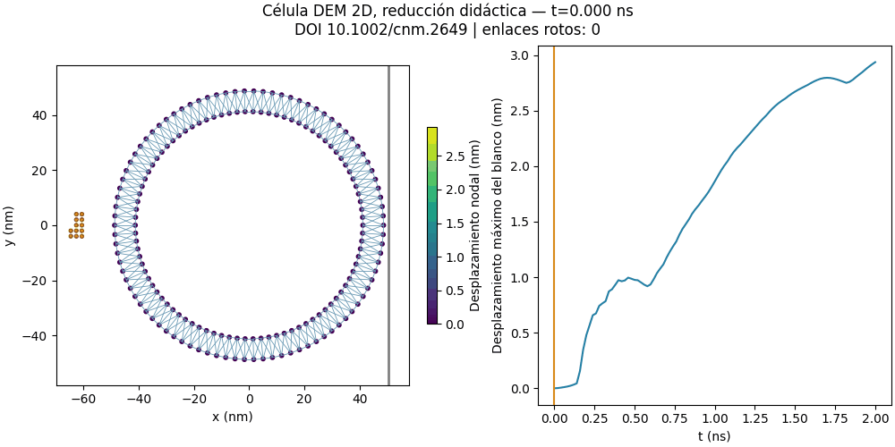
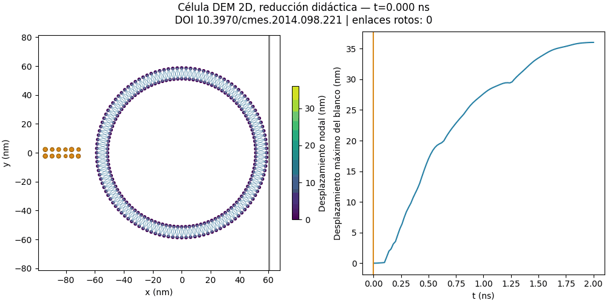
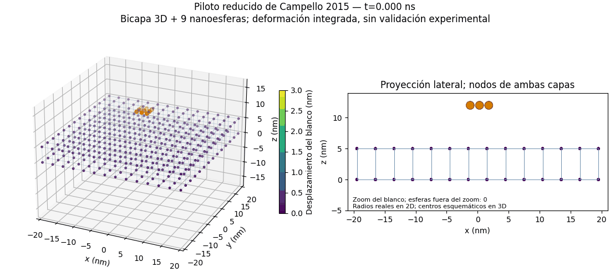
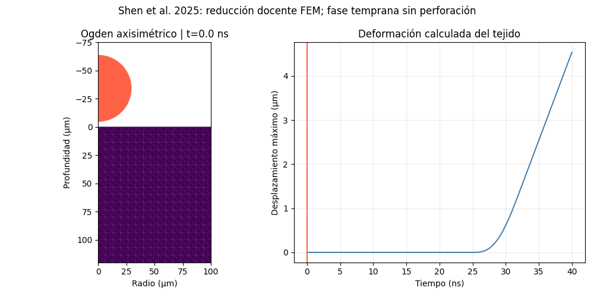
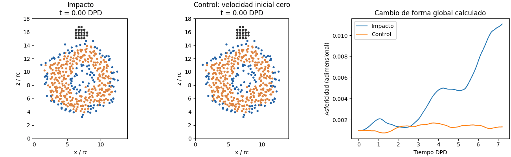
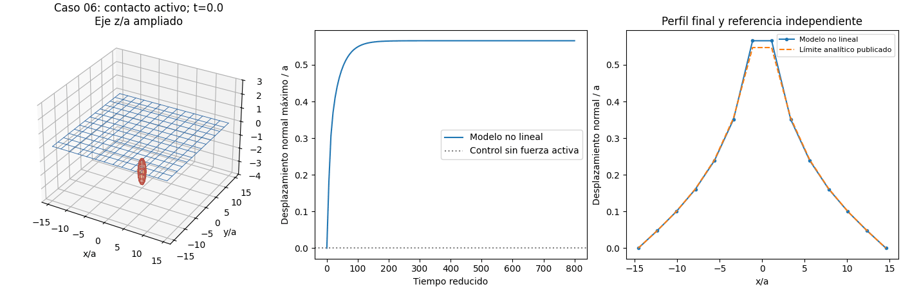
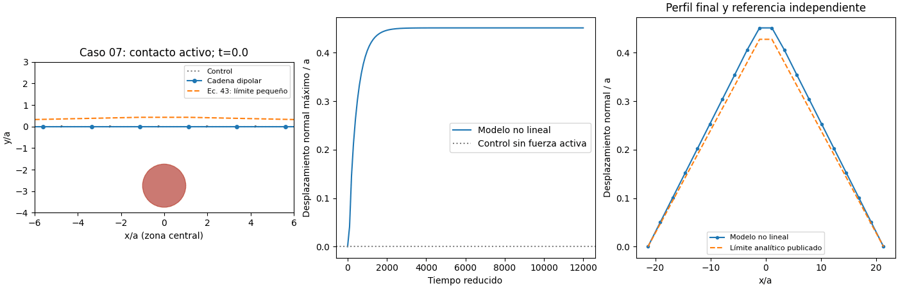
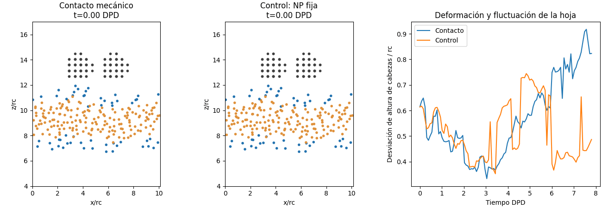
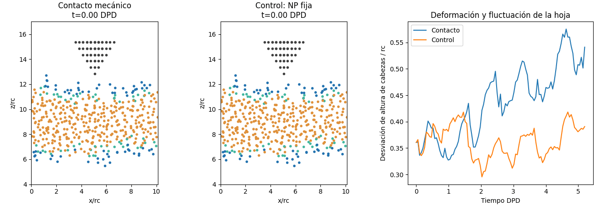

# Las nueve animaciones

[Volver al inicio](README.md)

Vistas pregeneradas de las implementaciones docentes. Se muestra el resultado calculado, sin ampliar artificialmente la deformación; las escalas y ampliaciones indicadas en cada figura deben respetarse. Los controles de los casos 05–09 ayudan a distinguir deformación por contacto y evolución sin excitación.

## 01 · Célula idealizada DEM 2D

Campello y Zohdi (2014) · [Artículo](https://doi.org/10.1002/cnm.2649) · [Ficha y paso a paso](casos/01_celula_individual/README.md)

Contacto lateral y deformación pequeña de la célula idealizada. El color y la curva permiten apreciar cambios difíciles de ver a escala global.

## 02 · Célula idealizada DEM 2D

Campello y Zohdi (2014) · [Artículo](https://doi.org/10.3970/cmes.2014.098.221) · [Ficha y paso a paso](casos/02_celula_multiples/README.md)

Varios proyectiles, cambio de forma y rotura de enlaces del modelo DEM. La rotura de un enlace numérico no demuestra daño en una célula real.

## 03 · Bicapa lipídica idealizada DEM 3D

Campello (2015) · [Artículo](https://doi.org/10.1007/s40430-014-0273-5) · [Ficha y paso a paso](casos/03_bicapa_dem/README.md)

Vista 3D y proyección lateral de la bicapa: se aprecia la depresión local producida por las partículas.

## 04 · Piel hiperelástica, reducción FEM axisimétrica

Shen et al. (2025) · [Artículo](https://doi.org/10.1016/j.taml.2024.100567) · [Ficha y paso a paso](casos/04_piel_ogden/README.md)

Fase temprana del impacto en piel: la indentación es pequeña en esta ventana y se aprecia mejor en la curva. No se simula perforación.

## 05 · Vesícula HTTT y agua explícita DPD

Arai, Yasuoka y Zeng (2013) · [Artículo](https://doi.org/10.1039/C3NR02024J) · [Ficha y paso a paso](casos/05_vesicula_dpd/README.md)

Colisión con una vesícula idealizada y comparación con velocidad inicial cero. La deformación se analiza mediante el cambio de forma global.

## 06 · Membrana artificial mínima: hoja elástica

Daddi-Moussa-Ider et al. (2019) · [Artículo](https://doi.org/10.1088/1367-2630/ab35d2) · [Ficha y paso a paso](casos/06_membrana_plana/README.md)

Empuje activo contra una hoja elástica artificial. El eje de deformación está ampliado; no corresponde a un disparo balístico.

## 07 · Membrana artificial mínima: cadena dipolar

Daddi-Moussa-Ider et al. (2019) · [Artículo](https://doi.org/10.1063/1.5080807) · [Ficha y paso a paso](casos/07_membrana_dipolar/README.md)

Empuje activo contra una cadena dipolar artificial y comparación con el perfil analítico. No es una célula ni una bicapa molecular.

## 08 · Bicapa H2T5, agua y dos NP rígidas

Zhang et al. (2015) · [Artículo](https://doi.org/10.1038/srep10525) · [Ficha y paso a paso](casos/08_bicapa_cooperativa/README.md)

Dos nanopartículas guiadas por resortes móviles contactan la bicapa. La curva incluye fluctuación térmica y se compara con el control.

## 09 · Bicapa DOPC H2E2(C5)2 y tetraedro rígido

Yong y Du (2023) · [Artículo](https://doi.org/10.1021/acs.jpcb.2c07460) · [Ficha y paso a paso](casos/09_bicapa_tetraedro/README.md)

Contacto temprano de un tetraedro con una bicapa DOPC, con traslación y rotación. La rugosidad se compara con el control; no es un cañón de genes.

