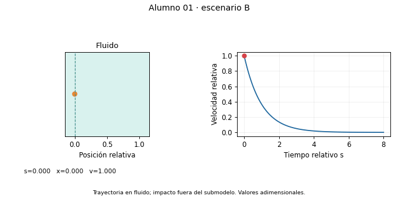
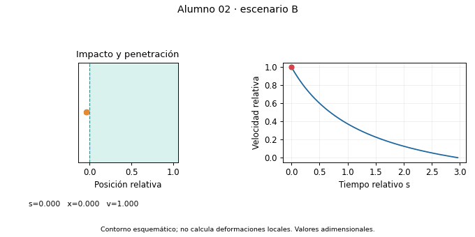
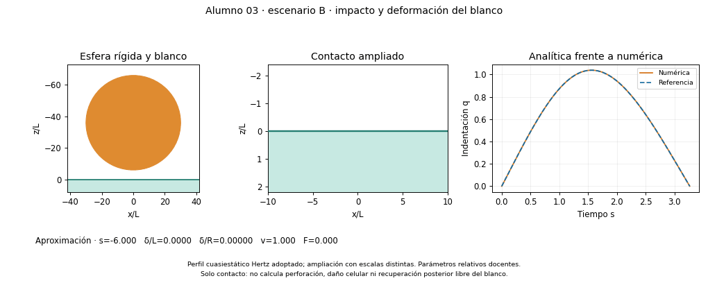
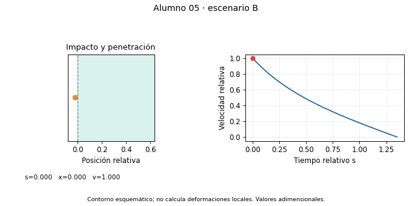
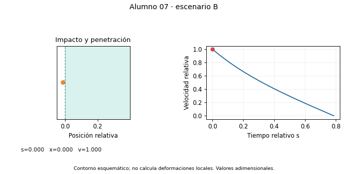
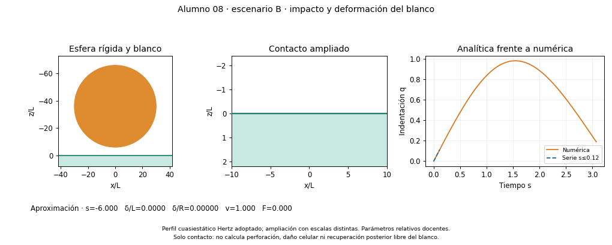
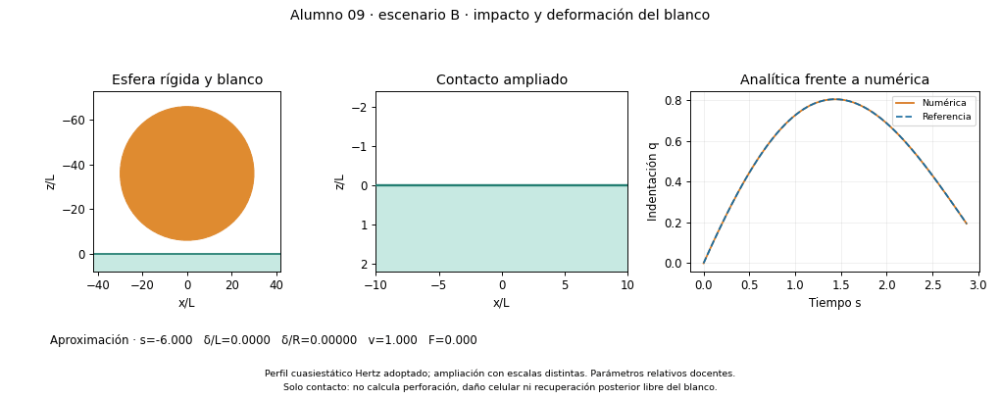

# Biobalística en Python: nueve artículos, nueve alumnos

Actividad de lectura, simulación y defensa del código con Visual Studio Code y GitHub Copilot.

**Nueve artículos diferentes, nueve DOI únicos.** Cada alumno recibe su ficha y un programa de ejemplo ejecutable. Debe interpretar la lectura, modificar el programa y explicar qué realiza cada función.

## Distribución sin artículos repetidos

| Alumno | Artículo | DOI | Modelo o submodelo asignado |
|---|---|---|---|
| [01](ALUMNO_01.md) | Fraire et al. (2022) | [10.1038/s41467-022-29713-7](https://www.nature.com/articles/s41467-022-29713-7) | Frenado viscoso de una nanopartícula |
| [02](ALUMNO_02.md) | Zhang, Rielly y Das (2015) | [10.3109/10717544.2014.887158](https://doi.org/10.3109/10717544.2014.887158) | Impacto con resistencia viscosa, inercial y de fluencia |
| [03](ALUMNO_03.md) | Zhang et al. (2015) | [10.1016/j.ces.2014.06.031](https://doi.org/10.1016/j.ces.2014.06.031) | Desaceleración y evento de parada |
| [04](ALUMNO_04.md) | Pirmoradi et al. (2015) | [10.1080/21645515.2015.1029211](https://doi.org/10.1080/21645515.2015.1029211) | Aceleración por arrastre a Reynolds intermedio |
| [05](ALUMNO_05.md) | Veysset et al. (2018) | [10.1016/j.jmbbm.2018.06.016](https://doi.org/10.1016/j.jmbbm.2018.06.016) | Penetración de una microesfera en gel |
| [06](ALUMNO_06.md) | Thorpe et al. (2025) | [10.1038/s41467-025-60761-x](https://www.nature.com/articles/s41467-025-60761-x) | Seguimiento lagrangiano de una partícula |
| [07](ALUMNO_07.md) | Shen et al. (2025) | [10.1016/j.taml.2024.100567](https://doi.org/10.1016/j.taml.2024.100567) | Modelo analítico de Poncelet y parada |
| [08](ALUMNO_08.md) | Veysset et al. (2020) | [10.1007/s11340-020-00639-9](https://link.springer.com/article/10.1007/s11340-020-00639-9) | Arrastre de Clift-Gauvin en un gel |
| [09](ALUMNO_09.md) | Saifoori, Nezamabadi y Ghadiri (2024) | [10.1007/s40571-024-00742-x](https://link.springer.com/article/10.1007/s40571-024-00742-x) | Contacto elástico, indentación y rebote |

Cada ficha contiene título completo, enlace, ubicación de ecuaciones o sección del modelo, alcance y paso a paso. Los temas cubren biobalística, penetración en geles y mecánica de contacto relacionada. El caso 09 es una referencia de mecánica de partículas, no un estudio de células.

## Alcance científico

Son reproducciones parciales de ecuaciones o submodelos identificados en las fuentes. Se explicitan las variables normalizadas y las simplificaciones. Los parámetros de práctica son docentes; no son calibraciones de organismos, recetas de laboratorio ni predicciones validadas de eficacia. Los casos 01/04/06 muestran movimiento en un fluido; 02/03/05/07/08 muestran impacto y penetración; 09 muestra indentación, fuerza y rebote elástico. El caso 06 prescribe un flujo y no reproduce el CFD completo.

Se ofrecen enlaces a los artículos. El caso 08 tiene editorial de suscripción y enlace al manuscrito de autores disponible en ResearchGate, que podría pedir cuenta; los otros casos tienen texto abierto o manuscrito de repositorio indicado. No se redistribuyen PDFs de terceros en este repositorio.

## Preparación común en Windows y Visual Studio Code

1. Instala Python 3 y Visual Studio Code. La extensión Python no incluye el intérprete: son componentes separados.
2. En este repositorio pulsa **Code → Download ZIP**, extrae la carpeta y abre esa carpeta en VS Code mediante **File → Open Folder**. También puedes clonarlo con Git.
3. Instala la extensión **Python** de Microsoft. Configura GitHub Copilot con tu propia cuenta y comprueba que puedes abrir su chat. No necesitas crear claves de API para estos programas.
4. Abre **Terminal → New Terminal** y crea el entorno:

   ```powershell
   py -m venv .venv
   .\.venv\Scripts\python.exe -m pip install -r requirements.txt
   ```

   Si `py` no existe, usa `python -m venv .venv`. Ejecuta los comandos desde la carpeta que contiene este README.
5. En VS Code ejecuta **Python: Select Interpreter** y selecciona `.venv`. Los comandos siguientes usan directamente su ejecutable; no es necesario activar el entorno ni modificar la política de PowerShell.
6. Abre la ficha de tu alumno y el archivo Python correspondiente. Lee la ecuación antes de pedir ayuda a Copilot.

Documentación oficial: [Python en VS Code](https://code.visualstudio.com/docs/python/python-tutorial) y [configuración de Copilot](https://code.visualstudio.com/docs/copilot/setup).

En macOS/Linux: crea el entorno con `python3 -m venv .venv` y reemplaza `.\.venv\Scripts\python.exe` por `.venv/bin/python`.


## Primera ejecución

Ejemplo para el alumno 01:

```powershell
.\.venv\Scripts\python.exe simulacion_01.py --escenario todos --verificar --animar
```

Sustituye `01` por tu número, entre `01` y `09`. El programa imprime el resultado de sus comprobaciones y crea CSV, parámetros y una figura en `resultados/alumno_01/`. Las figuras se guardan en archivo; abre `comparacion.png` para verlas.

Para revisar todos los programas, uno por uno:

```powershell
.\.venv\Scripts\python.exe verificar_todos.py
```

## Qué debe explicar cada alumno

1. La ecuación, sus variables, supuestos y la ubicación en su artículo.
2. La estructura del archivo y el recorrido desde `main()`.
3. Qué recibe, calcula y devuelve cada función; unidades o normalización y forma de los arreglos.
4. Qué hacen el integrador, la comprobación, la exportación y las gráficas, cuando correspondan.
5. Qué cambió personalmente y cómo comprobó que el cambio conserva el modelo.
6. Qué permiten concluir las simulaciones y qué no está validado con experimentos.

Consulta [guía de Copilot](GUIA_COPILOT.md) y [evaluación docente](GUIA_DOCENTE.md).

## Archivos

- `ALUMNO_01.md` a `ALUMNO_09.md`: pasos específicos, lectura, reto y defensa.
- `simulacion_01.py` a `simulacion_09.py`: modelos individuales que usan el módulo común `animaciones.py`.
- `requirements.txt`: dependencias comunes.
- `verificar_todos.py`: comprobaciones de nueve fuentes distintas y ejecución de los nueve programas.
- `FUENTES.json`: referencias, trazabilidad y alcance por caso.
- `VERIFICACION.json`: resultado de la revisión local, si ya se generó.

## Licencias

El código y las consignas originales del repositorio se ofrecen bajo MIT. Esa licencia no se extiende a los artículos enlazados, que conservan sus propios derechos y licencias. No se incluyen nombres ni datos personales de alumnos.

## Animaciones y mediciones

[**Abrir las nueve simulaciones interactivas**](visor_simulaciones.html): descarga el repositorio y abre ese HTML con tu navegador (GitHub muestra su código). Tiene selector de alumno y escenario, reproducción, pausa, control del tiempo y curvas sincronizadas. No necesita servidor.

Cada programa genera su propio `visor.html`, `metricas.json`, CSV y figura. Añade `--animar` para guardar `animacion.gif`. Las animaciones son resultados numéricos con parámetros docentes adimensionales. Los contornos, la esfera ampliada y el tramo de aproximación previo al impacto son esquemas. No representan imágenes experimentales ni un cálculo de deformación celular.

| Casos | Qué se ve | Qué se cuantifica |
|---|---|---|
| 01, 04, 06 | Movimiento de partícula en fluido | Posición y velocidad; impacto fuera del submodelo |
| 02, 03, 05, 07, 08 | Contacto inicial y penetración en un blanco | Profundidad máxima, velocidad y tiempo de parada |
| 09 | Compresión elástica y rebote de esfera contra pared | Indentación máxima, fuerza, energía y restitución |

Para medir deformación **local** de una célula o un tejido se necesita un modelo continuo con geometría y ley constitutiva. Estas prácticas se concentran en modelos que el alumno pueda recorrer y comprobar; no convierten profundidad de penetración en deformación unitaria.

### Vistas previas animadas

**Alumno 01: Frenado viscoso de una nanopartícula**



**Alumno 02: Impacto con resistencia viscosa, inercial y de fluencia**



**Alumno 03: Desaceleración y evento de parada**



**Alumno 04: Aceleración por arrastre a Reynolds intermedio**


**Alumno 05: Penetración de una microesfera en gel**



**Alumno 06: Seguimiento lagrangiano de una partícula**


**Alumno 07: Modelo analítico de Poncelet y parada**



**Alumno 08: Arrastre de Clift-Gauvin en un gel**



**Alumno 09: Contacto elástico, indentación y rebote**



Al copiar una práctica a otra carpeta, incluye `animaciones.py`. En el caso 09 la indentación es una magnitud global; el programa no calcula deformación unitaria, tensiones ni daño.
