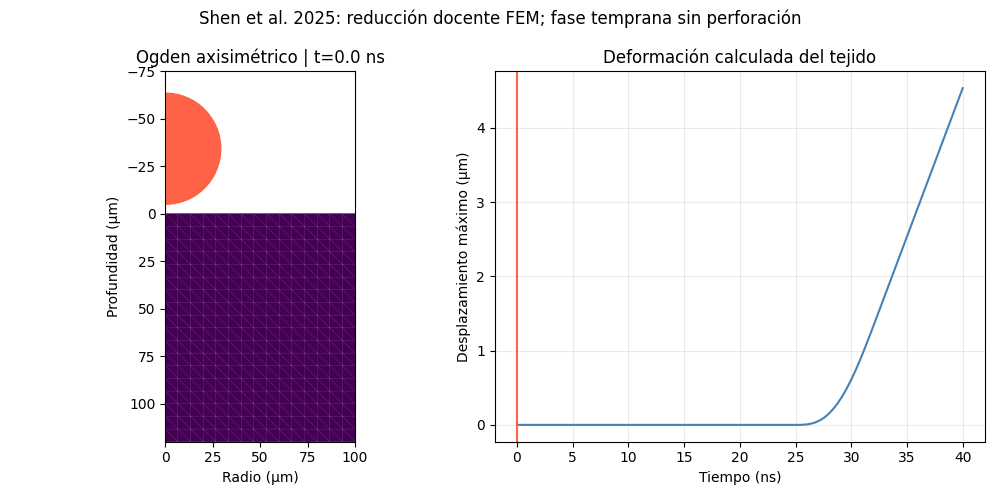
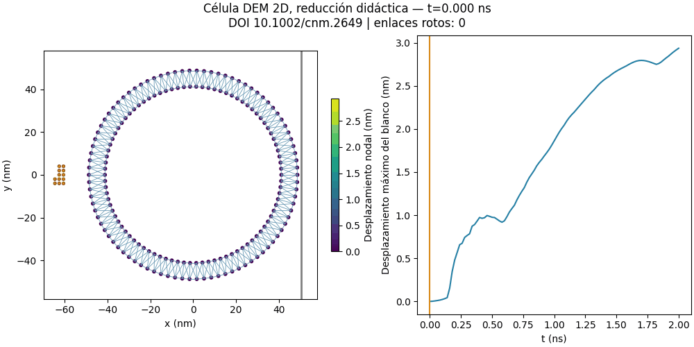
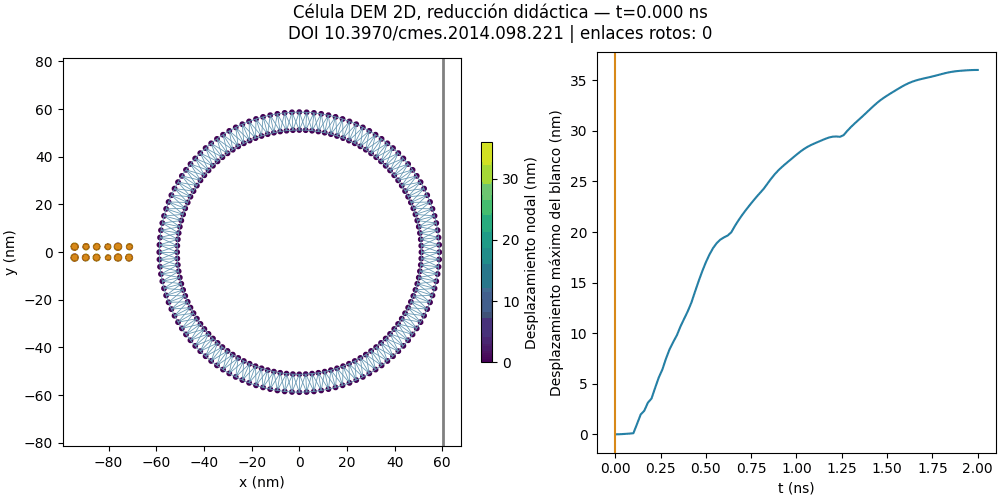
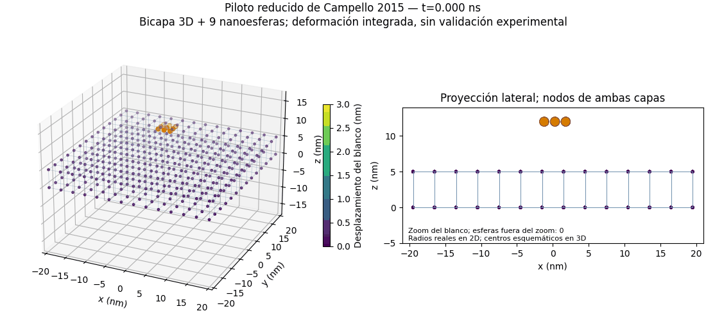

# Biobalística en células y tejidos: simulaciones en Python

> **Actividad en revisión. La selección anterior de nueve artículos de contacto general no cumple el requisito de biobalística celular o tisular. Sus animaciones no son réplicas de nueve modelos biológicos.**

La actividad prevista exige nueve artículos distintos, uno por alumno, y una simulación de cada modelo que calcule el impacto de micro/nanoesferas y la deformación del blanco. Incluye ecuaciones, funciones explicadas, comparación analítica cuando corresponda y defensa del código en Visual Studio Code con ayuda de GitHub Copilot.

**Estado actual: cuatro implementaciones didácticas reducidas de cuatro artículos distintos; cero réplicas completas verificadas; selección de nueve aún incompleta. La distribución definitiva para los nueve alumnos está pendiente.**

Consulta la [revisión de biobalística](REVISION_BIOBALISTICA.md) y el [registro de fuentes y pendientes](SELECCION_BIOBALISTICA.json). La tabla diferencia modelos confirmados, textos incompletos y el candidato que podría no satisfacer la deformación causada por impacto.


**Actualización 14 de noviembre:** se retiran de la asignación los candidatos sin texto/modelo abierto verificado y se añade Arai et al. (2013) como candidato de colisión en vesícula, aún sin implementar. Las tres fuentes anteriores de Campello son copias públicas de autor cuya licencia abierta no se ha confirmado. El nuevo caso de piel usa un artículo CC BY 4.0. Consulta el [estado de selección](REVISION_BIOBALISTICA.md).

## Impacto temprano en piel: cuarto artículo

[Shen et al. (2025), DOI 10.1016/j.taml.2024.100567](https://doi.org/10.1016/j.taml.2024.100567), acceso abierto CC BY 4.0. El nuevo [paso a paso y mapa de funciones](PIEL_OGDEN.md) explica la energía de Ogden, FEM axisimétrico, contacto, integración y comparación analítica Poncelet. La deformación se calcula a partir de posiciones nodales. Es una reducción de impacto temprano, sin perforación; conserva las unidades impresas y declara las fuertes compresiones locales y los cambios respecto al artículo.

```powershell
.\.venv\Scripts\python.exe piel_ogden.py --animar
.\.venv\Scripts\python.exe verificar_piel.py
```



## Impacto sobre una célula completa: dos artículos distintos

Se añadieron [dos programas celulares y su explicación de funciones](CASOS_CELULARES.md), basados en las leyes DEM de dos publicaciones distintas de Campello y Zohdi (2014). Cada célula tiene dos capas, enlaces circunferenciales/radiales/cruzados, presión, contacto, arrastre y ruptura. Son reducciones docentes con parámetros y diferencias declarados; no reproducen las figuras o tablas completas.

```powershell
.\.venv\Scripts\python.exe caso_celular_01.py --animar
.\.venv\Scripts\python.exe caso_celular_02.py --muestras 3 --animar
.\.venv\Scripts\python.exe verificar_celulas.py
```





`VERIFICACION_CELULAS.json` registra controles de fuerzas, vuelo libre analítico, refinamiento temporal y control sin proyectiles. Las copias de autor son consultables, pero no se afirma que tengan licencia abierta. La selección de nueve artículos que cumpla simultáneamente todos los requisitos sigue pendiente.

## Primer piloto de deformación calculada

[Campello (2015), ejemplo 5.3](https://doi.org/10.1007/s40430-014-0273-5): bicapa lipídica representada por nodos con inercia, enlaces, contacto y arrastre. La animación proviene de las posiciones integradas de ambas capas. Es una **reducción didáctica 3D**, no una reproducción completa de los resultados publicados.

Lee [el paso a paso, ecuaciones, diferencias y explicación de funciones](PILOTO_MEMBRANA.md).



## Ejecutar el piloto en Visual Studio Code

Descarga **Code → Download ZIP**, extrae la carpeta y ábrela en VS Code. Instala Python y la extensión Python de Microsoft; elige el intérprete del entorno creado abajo. Copilot puede ayudar a estudiar el código y no es necesario para ejecutarlo.

```powershell
py -m venv .venv
.\.venv\Scripts\python.exe -m pip install -r requirements.txt
.\.venv\Scripts\python.exe piloto_membrana.py --animar
.\.venv\Scripts\python.exe verificar_piloto.py
```

Abre `resultados/piloto_membrana/piloto_membrana.gif`. El NPZ guarda estados; el CSV guarda desplazamiento máximo, altura de proyectiles y enlaces rotos; el JSON documenta parámetros. Las comprobaciones independientes están en `VERIFICACION_PILOTO.json`. Una comprobación numérica no valida el comportamiento de células reales.

## Material auxiliar anterior

Los archivos `simulacion_01.py`–`09.py`, sus fichas `ALUMNO_01.md`–`09.md`, los nueve GIF antiguos y `visor_simulaciones.html` corresponden a [fundamentos de contacto](FUNDAMENTOS_CONTACTO.md). Se conservan para estudiar mecánica y soluciones analíticas; **no son las nueve asignaciones biológicas solicitadas**. Su verificación es matemática y no demuestra correspondencia con modelos de tejidos o células.
