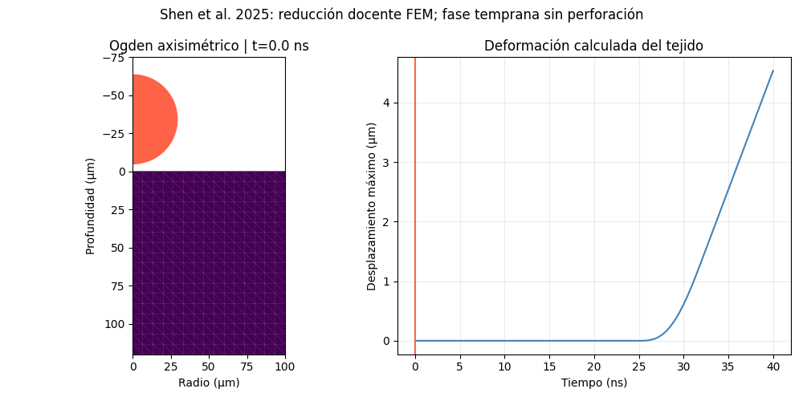

# Alumno 04 — Shen et al. (2025)

**Artículo distinto:** *Investigation of dynamic behavior of human skin tissue under micro-particle impact in the context of transdermal drug delivery: numerical and analytical perspectives*. [DOI 10.1016/j.taml.2024.100567](https://doi.org/10.1016/j.taml.2024.100567). [Lectura de texto completo](<https://pubs-en.cstam.org.cn/data/article/taml/preview/pdf/20250202.pdf>). Acceso: CC BY 4.0.

**Tipo:** Biobalística tisular; impacto temprano. **Blanco:** Piel hiperelástica, reducción FEM axisimétrica. Es una implementación docente reducida; las diferencias con el artículo se explican en [la guía del modelo](../../docs/modelos/PIEL_OGDEN.md).

## Paso a paso

1. Descarga **Code → Download ZIP** desde GitHub, extrae el archivo y abre la carpeta en Visual Studio Code.
2. Abre **Terminal → New Terminal** y ejecuta desde la raíz:

```powershell
py -m venv .venv
.\.venv\Scripts\python.exe -m pip install -r requirements.txt
.\.venv\Scripts\python.exe ejecutar_caso.py 4 --animar
.\.venv\Scripts\python.exe pruebas/verificar_piel.py
```

3. Selecciona `.venv` como intérprete en VS Code. Abre `src/piel_ogden.py` y el motor que indica la guía. Copilot ayuda a estudiar el código; no hace falta para ejecutarlo.
4. Consulta las salidas en `resultados/piel_ogden`. La [vista previa GIF](animacion.gif) y [figura](figura.png) del repositorio son resultados pregenerados; el comando anterior genera tus propios archivos.
5. Abre el CSV de métricas y el JSON de parámetros de esa carpeta. Relaciona posiciones, contacto y deformación con un mismo instante. No concluyas daño celular solo por ver un cambio de forma.
6. Ejecuta el control y la comparación sugerida en [la guía](../../docs/modelos/PIEL_OGDEN.md). Distingue los valores publicados, las elecciones docentes y las variables que cambiaste.

## Trabajo analítico y explicación del código

Deriva la trayectoria Poncelet y explica por qué no calcula por sí sola la deformación FEM. Revisa unidades, J y compresibilidad.

Para cada función explica entrada, unidades, retorno, forma de los arreglos y quién la llama. Señala dónde se calcula la fuerza sobre el blanco, dónde se aplica la reacción y dónde se actualizan las coordenadas. Explica cómo el dibujado utiliza esas coordenadas.

Pide a Copilot: «Lee mi guía y explícame una sola función cada vez. Pregúntame por signos, dimensiones y supuestos. Ayúdame a derivar el límite analítico antes de modificar el programa. No atribuyas al artículo un parámetro añadido por el ejercicio». Revisa el diff y registra una ayuda aceptada y una corrección razonada.

Entrega código comentado, derivación, parámetros, CSV, curvas, animación, control y una defensa oral. Las comprobaciones numéricas no validan el comportamiento de células reales ni convierten la reducción en una reproducción completa del artículo.

## Qué observar en la animación

Fase temprana del impacto en piel: la indentación es pequeña en esta ventana y se aprecia mejor en la curva. No se simula perforación.


