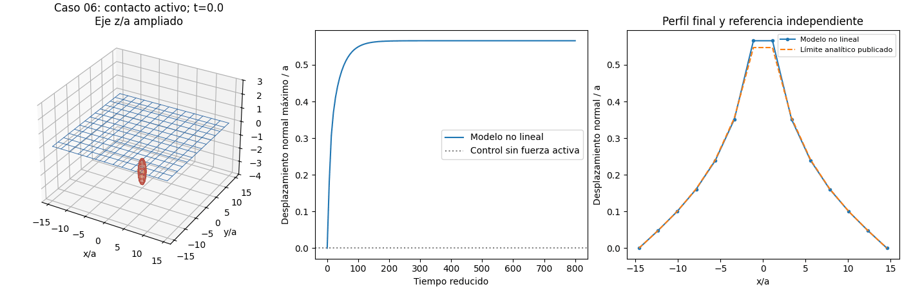

# Caso 06 — Víctor Ronaldo Zuta Rodríguez

**Tu actividad asignada.** [Instalación y tutoría con Copilot](../../docs/INICIO_VSCODE_COPILOT.md) · [Volver a la lista del grupo](../../README.md#actividades-asignadas).


**Artículo distinto:** *Theory of active particle penetration through a planar elastic membrane*. [DOI 10.1088/1367-2630/ab35d2](https://doi.org/10.1088/1367-2630/ab35d2). [Lectura de texto completo](<https://user.thphy.uni-duesseldorf.de/hlowen/doc/op/op0409.pdf>). Acceso: CC BY 3.0.

**Tipo:** Penetración mecánica activa; no balística. **Blanco:** Membrana artificial mínima: hoja elástica. Es una implementación docente reducida; las diferencias con el artículo se explican en [la guía del modelo](../../docs/modelos/CASO_06.md).

## Paso a paso en Visual Studio Code

1. Descarga **Code → Download ZIP** desde GitHub, extrae el archivo y abre la carpeta en Visual Studio Code.
2. Abre **Terminal → New Terminal** y ejecuta desde la raíz:

```powershell
py -m venv .venv
.\.venv\Scripts\python.exe -m pip install -r requirements.txt
.\.venv\Scripts\python.exe ejecutar_caso.py 6 --animar
.\.venv\Scripts\python.exe pruebas/verificar_nuevos.py
```

3. Selecciona `.venv` como intérprete en VS Code. Abre `src/caso_06_plana.py` y el motor que indica la guía. Copilot ayuda a estudiar el código; no hace falta para ejecutarlo.
4. Consulta las salidas en `resultados/caso_06`. La [vista previa GIF](animacion.gif) y [figura](figura.png) del repositorio son resultados pregenerados; el comando anterior genera tus propios archivos.
5. Abre el CSV de métricas y el JSON de parámetros de esa carpeta. Relaciona posiciones, contacto y deformación con un mismo instante. No concluyas daño celular solo por ver un cambio de forma.
6. Ejecuta el control y la comparación sugerida en [la guía](../../docs/modelos/CASO_06.md). Distingue los valores publicados, las elecciones docentes y las variables que cambiaste.

## Trabajo analítico y explicación del código

Deduce la serie de Fourier de pequeña deformación y compara el perfil con la solución no lineal.

Para cada función explica entrada, unidades, retorno, forma de los arreglos y quién la llama. Señala dónde se calcula la fuerza sobre el blanco, dónde se aplica la reacción y dónde se actualizan las coordenadas. Explica cómo el dibujado utiliza esas coordenadas.

Pide a Copilot: «Lee mi guía y explícame una sola función cada vez. Pregúntame por signos, dimensiones y supuestos. Ayúdame a derivar el límite analítico antes de modificar el programa. No atribuyas al artículo un parámetro añadido por el ejercicio». Revisa el diff y registra una ayuda aceptada y una corrección razonada.

Entrega código comentado, derivación, parámetros, CSV, curvas, animación, control y una defensa oral. Las comprobaciones numéricas no validan el comportamiento de células reales ni convierten la reducción en una reproducción completa del artículo.

## Construir tu implementación con ayuda de Copilot

1. Abre `src/caso_06_plana.py` desde la raíz del proyecto y sigue los imports hasta el motor indicado en [la guía del modelo](../../docs/modelos/CASO_06.md). Dibuja el recorrido configuración → geometría → fuerzas → integrador → medición → animación.
2. Antes de modificar código, deduce el límite analítico descrito en esta ficha. Comprueba un valor a mano y anota sus unidades.
3. Usa **File → Save As** para guardar una copia del programa principal como `src/mi_caso_06.py`, dentro de `src/`. Los motores compartidos deben conservarse. Este archivo será tu versión de trabajo.
4. En el chat de Copilot, añade como contexto el programa y su motor. Pide: «Estudio el caso 06. Explica una función por vez; hazme identificar entradas, unidades, retorno y quién la llama. Después ayúdame a escribir una función pequeña de comprobación analítica. No cambies las ecuaciones del artículo».
5. Implementa la comprobación, explica cada línea y ejecútala. Para generar resultados con tu copia:

```powershell
.\.venv\Scripts\python.exe src/mi_caso_06.py --salida resultados/mi_caso_06 --animar
```

6. Compara los CSV y las curvas con la referencia. Aplica la comparación o control de la guía, cambia una sola cosa por ensayo y guarda cada ejecución en otra carpeta. Distingue el paso temporal del número de cuadros del GIF.
7. Pon un punto de interrupción en una función de fuerza, inicia la depuración de tu copia en VS Code y observa una entrada y su retorno. No ejecutes todo el modelo paso a paso: inspecciona una llamada y explica lo que contiene.
8. Registra una ayuda aceptada y una corrección que hiciste a Copilot. La defensa incluye explicar sin asistencia una función de fuerzas, una de integración y una de medición o dibujo.

**Comprobación antes de entregar:** ejecución propia sin errores; parámetros y unidades; derivación analítica con hipótesis; control; CSV y curvas; GIF generado desde los mismos estados; mapa de funciones y explicación oral. Revisa también [la guía de construcción](../../docs/APRENDE_A_CONSTRUIR.md).

## Qué observar en la animación

Empuje activo contra una hoja elástica artificial. El eje de deformación está ampliado; no corresponde a un disparo balístico.


