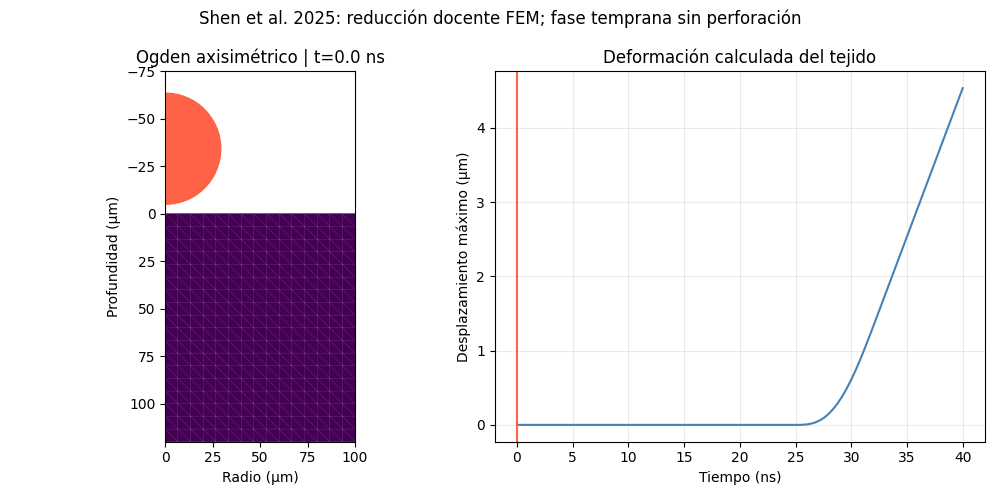

# Impacto temprano de una microesfera en piel: Ogden y elementos finitos

Shen, Huang, Wen y Roth (2025), *Investigation of dynamic behavior of human skin tissue under micro-particle impact in the context of transdermal drug delivery: numerical and analytical perspectives*. [Artículo abierto, DOI 10.1016/j.taml.2024.100567](https://doi.org/10.1016/j.taml.2024.100567); [texto completo CC BY 4.0](https://pubs-en.cstam.org.cn/data/article/taml/preview/pdf/20250202.pdf).

Esta práctica implementa una **reducción FEM axisimétrica de la fase temprana**. La deformación procede de integrar las fuerzas internas del tejido y el contacto con la esfera. No reproduce las curvas publicadas ni el acoplamiento SPH-FEM de RADIOSS; tampoco representa perforación o ruptura. Es el cuarto artículo con una implementación docente en este repositorio, no la entrega completa de nueve casos.



## Paso a paso en Visual Studio Code

1. Descarga el repositorio con **Code → Download ZIP**, extrae y abre su carpeta en VS Code.
2. Instala Python y la extensión Python de Microsoft. Abre **Terminal → New Terminal**.
3. Crea el entorno e instala las dependencias:

```powershell
py -m venv .venv
.\.venv\Scripts\python.exe -m pip install -r requirements.txt
```

4. Selecciona **Python: Select Interpreter → .venv**. Ejecuta:

```powershell
.\.venv\Scripts\python.exe src/piel_ogden.py --animar
.\.venv\Scripts\python.exe pruebas/verificar_piel.py
```

5. Abre `resultados/piel_ogden/piel_ogden.gif`. El CSV contiene tiempo, posición y velocidad de la esfera, desplazamiento máximo, energías, mínimo determinante de deformación y solape de contacto. El NPZ contiene las coordenadas completas, no solo una profundidad.
6. Ejecuta un control sin impacto y un refinamiento temporal:

```powershell
.\.venv\Scripts\python.exe src/piel_ogden.py --control --animar --salida resultados/piel_control
.\.venv\Scripts\python.exe src/piel_ogden.py --dt 5e-11 --animar --salida resultados/piel_dt_mitad
```

7. Compara las mismas columnas del CSV al mismo tiempo físico. Guarda tus conclusiones, no solo las imágenes.

## Qué se toma del artículo y qué se adapta

La ecuación 7 define una energía de Ogden de un término, con estiramientos desviadores y penalización volumétrica. Se usan los valores impresos de `mu=10 Pa`, `alfa=16`, `nu=0.48`; esfera de acero de diámetro 58.5 µm, densidad 7800 kg/m³ y velocidad inicial 200 m/s. Las densidades de epidermis y dermis son 1217 y 1116 kg/m³; la interfaz se sitúa a 86 µm.

Son decisiones docentes: malla de triángulos lineales axisimétricos, radio 160 µm, profundidad truncada a 200 µm, hueco inicial 5 µm, duración 40 ns, `dt=0.1 ns` y contacto por penalidad `2e15 Pa/m`. La hipodermis queda fuera de esta ventana espacial. La superficie recibe fuerzas en sus nodos con áreas anulares de referencia. Los bordes exterior y profundo están fijos; en el eje se fija el desplazamiento radial. Estos cambios deben explicarse antes de comparar con el artículo.

**Limitación material importante:** se conserva la unidad Pa publicada y el prefactor `mu/alfa`; no se reemplazan por kPa ni por `2*mu/alfa²`. Esta convención y el módulo volumétrico impreso permiten compresiones locales muy grandes. El ejemplo llega a `J_min≈0.32`. Por ello es una demostración matemática del modelo transcrito, con volumen local muy alterado; no una predicción validada de piel real. Alargar el cálculo puede invertir elementos. El programa se detiene si `J<=0`.

## Ecuaciones y estructura

Para cada triángulo, las coordenadas integradas determinan el gradiente de deformación `F`. La componente circunferencial es el radio actual medio dividido por el radio de referencia. Con `J=det(F)` y `lambda_bar=lambda/J^(1/3)`:

`W = mu/alfa*(sum(lambda_bar**alfa)-3) + K/2*(J-1)**2`,

`K = 2*mu*(1+nu)/(3*(1-2*nu))`.

`energia_tension` calcula `P=dW/dF` mediante la descomposición singular. `fuerzas_internas` ensambla `-dU/dx`, incluyendo el término circunferencial. Cada nodo satisface `m*a=F_interna+F_contacto`; la esfera recibe la reacción axial opuesta. Velocity Verlet integra ambas dinámicas conjuntamente. La animación dibuja esas posiciones.

| Función | Entrada y resultado | Qué debes poder explicar |
|---|---|---|
| `malla` | Parámetros → nodos, triángulos, gradientes, volúmenes, masas, restricciones y áreas | Por qué el volumen es `area*2*pi*radio` y las masas se distribuyen entre tres nodos |
| `energia_tension` | `F`, parámetros → `W`, `P`, `J` | Qué son estiramientos, objetividad y derivada de energía |
| `fuerzas_internas` | Coordenadas y malla → fuerzas, energía y `J` | Cómo se pasa de una ley material a fuerzas nodales |
| `contacto` | Superficie y centro de esfera → fuerzas, reacción, energía y solape | Por qué el contacto es unilateral; qué error introduce la penalidad |
| `poncelet` | Tiempo y propiedades → profundidad, velocidad y tiempo de parada | Por qué esta solución de trayectoria no proporciona la deformación espacial |
| `simular` | Parámetros, destino → estados y métricas | Orden de los dos medios pasos de velocidad, posiciones y reevaluación de fuerzas |
| `representar` | Estados integrados → GIF y PNG | Diferencia entre calcular un estado y dibujarlo |
| `main` | Argumentos de terminal → ejecución | Valor por defecto, validación de argumentos y control sin impacto |
| `verificar` en `pruebas/verificar_piel.py` | Sin argumentos → informe JSON | Qué comprueba cada control y qué queda sin validar |

## Aprender a construir una solución analítica

Empieza por vuelo libre: antes del contacto, `z=z0+v0*t`. Obtén el instante de primer contacto `hueco/v0`; compruébalo con el CSV. Es una comprobación independiente del FEM.

Después estudia una capa homogénea con la ecuación de Poncelet del artículo:

`m*dv/dt = -(B*v²+C)`, `B=rho*pi*d²*Cd/8`, `C=R*pi*d²/4`.

Separa variables para obtener `tf=m/sqrt(B*C)*atan(v0*sqrt(B/C))`. Integra `v(t)=sqrt(C/B)*tan(sqrt(B*C)/m*(tf-t))` para hallar `z(t)`, como hace `poncelet`. Limita la solución al tiempo de parada. En esta referencia se usan `Cd=.35` y `R=12 MPa` para epidermis.

La referencia Poncelet es independiente del FEM. No se aplica como fuerza adicional, no se usa para imponer la forma del tejido y no se afirma concordancia con el FEM reducido. En la ley de Ogden puedes estudiar además una extensión homogénea incomprensible `F=diag(lambda,lambda**(-1/2),lambda**(-1/2))`, derivar `W(lambda)` y comparar su derivada con una diferencia finita.

## Trabajo con Copilot y defensa oral

Usa Copilot como tutor con instrucciones pequeñas:

- «Explícame `malla` línea por línea y dibuja los índices de una sola celda. No cambies el código».
- «Deriva `P=dW/dF` para los estiramientos principales y explica el término que resta la media».
- «Ayúdame a deducir la solución de Poncelet por separación de variables; espera mi intento antes del siguiente paso».
- «Propón una comprobación de conservación de energía que incluya energía cinética, interna y de contacto».
- «Explícame por qué una prueba numérica aprobada no confirma que estos parámetros representen piel real».

Entrega el código comentado por ti, una figura con el control, otra con refinamiento, el desarrollo analítico y una página de límites. En la defensa debes señalar dónde se calculan las fuerzas, dónde se integran las posiciones y dónde únicamente se dibujan. Explica qué significa `J_min` y por qué no puedes llamar a esta animación una perforación validada.

## Comprobaciones ejecutadas

`pruebas/evidencia/VERIFICACION_PIEL.json` contiene comprobaciones de derivada de energía, fuerza nodal, objetividad, equilibrio de contacto, vuelo libre, solución Poncelet, paso temporal, energía y control sin proyectil. El cambio temporal del desplazamiento final fue aproximadamente 0.002 % y la deriva de energía 0.00016 % en el ejemplo. Quedan pendientes convergencia espacial, sensibilidad de contacto, cotejo con curvas publicadas y validación física.
